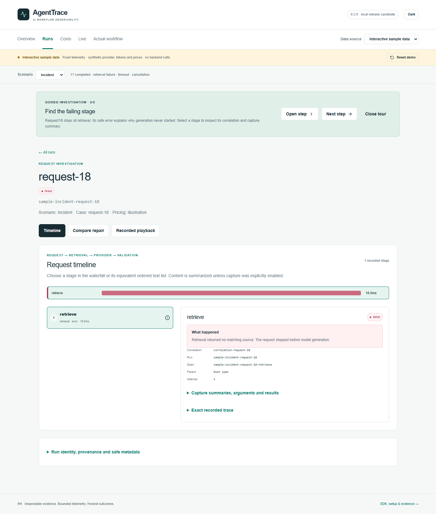

# AgentTrace

[](https://github.com/FishRaposo/agenttrace/actions/workflows/ci.yml)
[](https://www.python.org/)
[](LICENSE)

**Find the failing step in an AI workflow, even when requests overlap.**

AgentTrace combines a dependency-free tracing SDK, a local collector and a
visual investigation dashboard. Follow twenty overlapping requests, locate a
retrieval failure, and compare its repair while the separate timeout and
cancellation remain visible. Concurrency, HTTP export and persistence are real;
bundled provider answers, usage and prices are synthetic.

This is the **0.2.0 release candidate**. Capture defaults change to summaries;
raw content requires explicit opt-in. See [capture/security](docs/SECURITY.md),
[actual setup](docs/portfolio-connected.md), [case study](docs/portfolio-case-study.md),
[verification](docs/portfolio-verification.md) and [review walkthrough](docs/portfolio-walkthrough.md).
The CI badge tracks upstream `main`; the release candidate's verification is local.



The [rendered gallery](docs/screenshots/README.md) also includes actual connected
runs. Inspect the [raw connected proof](docs/evidence/connected/report.json) and
[benchmark observations](docs/evidence/tracing-benchmark.json), or independently
check their hashes/contracts with `make portfolio-evidence`.

## Quick demonstration

From the repository root (use `python3` if `python` is not on your PATH; `make`
auto-selects `python3` when available):

```bash
make install       # SDK + server dev extras + dashboard lockfile install
make demo          # dependency-free SDK JSONL example
make evidence      # deterministic server-side portfolio evidence bundle
```

The evidence command writes ignored files under `artifacts/portfolio/` and
verifies checksums plus the committed golden result. See
[`docs/EVIDENCE.md`](docs/EVIDENCE.md) for the review/replay walkthrough.

To run the local services separately:

```bash
# See docs/portfolio-connected.md for a disposable DB and exact environment.
python -m uvicorn app.main:app --app-dir server --host 127.0.0.1 --port 8300
cd dashboard && npm run dev -- --hostname 127.0.0.1 --port 3404
```

The dedicated review API is `http://127.0.0.1:8300/docs`; the dashboard is
`http://localhost:3404`. Configure `NEXT_PUBLIC_API_URL` before building it.
Enable the bundled launcher explicitly with `PORTFOLIO_LAUNCH_ENABLED=true`.
Connected failures show Retry and explicit sample entry.

The dashboard and this installed SDK command run the same implementation:

```bash
python -m agenttrace.portfolio --scenario incident --endpoint http://127.0.0.1:8300
python -m agenttrace.portfolio --scenario repaired --endpoint http://127.0.0.1:8300
```

### Portfolio demo (dashboard only, no backend)

For reviewers who only need the UI — deterministic fixtures, no server, no
credentials:

```bash
make demo-ui
# or: cd dashboard && npm run demo:ui
```

Open `http://localhost:3000`. The persistent label reads **Interactive sample data**.

**Click path:**

1. **Investigate a failure** → separate request lanes → failed retrieval.
2. Select its span and inspect the readable error, stage and correlation.
3. Compare the repaired retrieval; timeout and cancellation remain separate.
4. Inspect **Costs** and deterministic **recorded playback**, then **Reset demo**.
5. Follow the actual-workflow link to reproduce with the SDK and collector.

The preview makes no backend/provider requests and uses no network fonts.
Playback never re-executes tools. Connected mode inspects actual saved spans and
actual collector events with explicit delivery completeness and provenance.

## What is delivered

- Dependency-free Python SDK (`sdk/`) with decorators, context-managed runs,
  JSONL/API exporters, provider wrappers, replay payloads, and deterministic
  cost tracking. The SDK can be installed without the server.
- Safety-bounded `agenttrace.issue_pr` SDK workflow with deterministic mock
  issue/planner providers, sandbox-contained edits, protected-branch guards,
  bounded shell-free tests, ordered audit/trace events, replay, and an explicit
  pause before any draft-PR intent. Offline mode makes no GitHub call.
- FastAPI collector (`server/`) with SQLite by default, optional PostgreSQL,
  canonical span/cost adapters, cost reports, run diffing, replay, and a JSON
  subset of OTLP HTTP traces.
- Deterministic head and tail sampling with stable SHA-256 decisions and
  timeout handling; sampling metadata is additive to existing responses.
- In-memory realtime publication by default, with an optional Redis adapter.
  Existing WebSocket and SSE routes remain compatibility facades.
- Persisted cost/latency alert rules and deduplicated events with open,
  acknowledged, and resolved states. Delivery remains local/log based.
- Single-tenant `admin`, `ingestor`, and `viewer` roles plus redacted audit
  records. `AUTH_REQUIRED=false` keeps the local demo credential-free; set it
  to `true` for a deployed collector.
- `monitoring/grafana/agenttrace-overview.json`, a portable dashboard artifact
  for cost, latency, throughput, errors, and sampling.
- A reproducible evidence bundle with canonical JSON, Markdown explanation,
  manifest hashes, realtime publication, sampling, alert, RBAC, audit, and
  replay plus issue-to-draft-PR safety coverage.

## Architecture

```text
agent code -> SDK -> JSONL or HTTP exporter -> FastAPI collector -> SQLite/PostgreSQL
                                                       |                 |
                                                       +--> realtime ----+--> dashboard
                                                       +--> replay/diff/cost/alerts
                                                       +--> OTLP/JSON export and ingest
```

The SDK and server have an intentional boundary. Server-only compatibility
contracts live in `server/app/internal/`; the server's small vendored core is
attributed and pinned in [`THIRD_PARTY_NOTICES.md`](THIRD_PARTY_NOTICES.md).
The SDK never imports that code. The SDK's local pricing table is retained and
golden-tested; server reporting uses the vendored registry for intentional
parity at the ingestion boundary.

## Installation and development

The canonical install path is:

```bash
python3 -m pip install -e "sdk[dev]"
python3 -m pip install -e "server[dev]"
cd dashboard && npm ci
```

The server wheel includes `app/internal/vendor_core` and can be installed in a
clean environment without any sibling checkout or external core package. The
optional Redis integration is installed only with `server[redis]`.

Useful targets:

| Command | Purpose |
| --- | --- |
| `make test` | SDK and server pytest suites |
| `make lint` | Ruff checks |
| `make format` | Ruff formatting |
| `make typecheck` | Pyright for SDK and server |
| `make demo-ui` | Dashboard in forced portfolio demo mode (no backend) |
| `make evidence` | Build and verify the offline evidence bundle |
| `make forbidden-scan` | Check for retired external dependency references |
| `make package` | Build both Python wheels |
| `make dashboard-test` | Chromium Playwright smoke test |

Direct verification commands used in CI are:

```bash
pytest sdk/tests -q
pytest server/tests -q
ruff check server/app sdk/agenttrace server/tests sdk/tests
ruff format --check server/app sdk/agenttrace server/tests sdk/tests
pyright server/app sdk/agenttrace
```

The absorption branch currently executes 132 SDK tests and 98 server tests. The
dashboard adds 29 Vitest unit tests and 12 Playwright Chromium smoke tests in
CI (`npm test`, `npm run test:e2e -- --project=chromium`).

## SDK example

```python
from agenttrace import HybridLLMClient, Tracer

tracer = Tracer()
client = HybridLLMClient(mode="sim", tracer=tracer)

with tracer.run("research-agent", correlation_id="demo"):
    answer = client.chat(
        "openai",
        "gpt-4o-mini",
        messages=[{"role": "user", "content": "Explain trace replay."}],
    )

tracer.flush()
print(answer.content)
```

Provider wrappers and manual decorators are documented in
[`docs/SDK.md`](docs/SDK.md). Simulation is deterministic; real providers are
opt-in and require their own credentials.

The issue-to-draft-PR workflow is additive and does not add server routes or
change the existing span, cost, exporter, or ingestion contracts. Its default
providers are deterministic and in-process. GitHub REST, LLM planning,
PostgreSQL, Redis, Celery, GitPython, and PyGithub adapters remain optional
integration work and are not imported by the default SDK path.

## HTTP surface

| Route | Purpose |
| --- | --- |
| `POST /api/traces`, `/api/traces/batch` | Native SDK span ingestion |
| `POST /api/traces/spans` | Canonical span-shaped ingestion adapter |
| `POST /api/traces/costs` | Canonical cost-record ingestion adapter |
| `GET /api/runs`, `/api/replay/runs/{id}` | Run listing and read-only replay |
| `GET /api/diff/runs` | Deterministic run comparison |
| `GET /api/costs/*` | Cost summaries and daily JSON/CSV reports |
| `GET /api/alerts`, `/api/alerts/latency` | Backward-compatible alert views |
| `/api/alerts/rules`, `/api/alerts/events` | Persisted alert rules, state, and acknowledgement |
| `GET/POST /api/otlp/v1/traces` | OTLP HTTP/JSON resource/span subset |
| `/ws/traces`, `/api/stream` | Realtime WebSocket and SSE compatibility routes |
| `/api/auth/*`, `/api/audit` | Local JWT auth, roles, and admin audit view |

Inbound adapters preserve existing JSON keys, enum vocabulary, unknown-value
fallbacks, and cost semantics. New sampling, provider, usage, and audit fields
are additive. See [`docs/COMPATIBILITY.md`](docs/COMPATIBILITY.md) and
[`docs/OTLP.md`](docs/OTLP.md).

## Configuration

The server reads `.env` values through Pydantic settings. Important defaults:

| Variable | Default | Meaning |
| --- | --- | --- |
| `DATABASE_URL` | `sqlite+aiosqlite:///./data/agenttrace.db` | Local persistence |
| `DATABASE_TYPE` | `sqlite` | `sqlite` or `postgres` |
| `AUTH_REQUIRED` | `false` | Require JWT for protected observability and mutation routes |
| `REALTIME_BACKEND` | `memory` | `memory` or optional `redis` |
| `TRACE_SAMPLING_MODE` | `off` | `off`, `head`, or `tail` |
| `TRACE_SAMPLE_RATE` | `1.0` | Stable SHA-256 retention rate |
| `TRACE_TAIL_SLOW_MS` | unset | Tail-sampling slow-span override |
| `TRACE_TAIL_KEEP_ERRORS` | `true` | Retain error/failed terminal traces |
| `REDIS_URL` | unset | Optional Redis transport/rate-limit backend |
| `AGENTTRACE_LLM_MODE` | `sim` | SDK simulation or opt-in real provider mode |
| `OPENAI_API_KEY` / `ANTHROPIC_API_KEY` | unset | Only needed for real provider calls |

For deployment and database options, see [`docs/DEPLOYMENT.md`](docs/DEPLOYMENT.md)
and [`docs/SECURITY.md`](docs/SECURITY.md). PostgreSQL, Redis, Docker, and
Grafana are optional integration surfaces, never default requirements.

## Evidence and portfolio review

`make evidence` runs the fixed SQLite/in-memory scenario, including canonical
ingestion, OTLP metadata, sampling, cost attribution, alert state, RBAC,
redaction, replay-shaped output, realtime publication, and a dependency-free
issue-to-draft-PR scenario. That scenario proves path and protected-branch
refusals, failing/passing test transitions, approval pause, draft-only intent,
ordered events, replay, and redaction without network access. It writes:

- `manifest.json` with mode, result hash, and reproducibility hash;
- canonical `report.json` and human-readable `report.md`;
- `checksums.sha256` for tamper detection.

The normalized report is compared with
`server/tests/fixtures/golden/portfolio-evidence.json`. Generated evidence is
ignored; only the small golden fixture is tracked. Verification failures are
non-zero for missing files, malformed JSON, checksum mismatches, tampering, or
golden drift.

## Deliberate boundaries

This repository delivers the local engineering core while keeping the default
path inspectable and reproducible. Hosted/team tenancy, hosted scheduling,
Slack/Discord/webhook delivery, external notification services, OTLP
protobuf/gRPC, and mandatory Redis/PostgreSQL/Grafana services remain deferred.
Live GitHub/LLM providers and server-hosted issue-to-PR automation are also
deferred. No changes are required in `aria-agent` or any other repository.

## License and provenance

AgentTrace is released under the MIT license. The server's vendored compatibility
subset is documented, attributed, and pinned in
[`THIRD_PARTY_NOTICES.md`](THIRD_PARTY_NOTICES.md). See
[`docs/decisions/2026-08-14-agenttrace-local-core.md`](docs/decisions/2026-08-14-agenttrace-local-core.md)
for the compatibility and pricing boundary decision.
The absorbed issue-to-draft-PR capability and source mapping are recorded in
[`docs/decisions/2026-08-16-issue-pr-agent-absorption.md`](docs/decisions/2026-08-16-issue-pr-agent-absorption.md).
