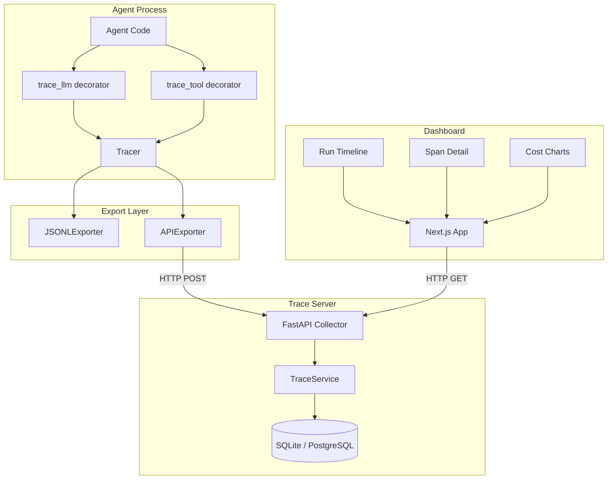

# Architecture

## System Overview

AgentTrace follows a three-tier architecture: SDK → Server → Dashboard.



## Data Flow

```
1. Agent calls trace_llm(prompt) or trace_tool(fn)
2. SDK creates a Span, records start_time
3. Original function executes
4. SDK records output, end_time, cost, tokens
5. Span is exported via configured exporter
6. APIExporter POSTs runs to `/api/runs` and spans to `/api/traces`
7. Server validates and persists to database
8. Dashboard queries /api/runs and /api/traces
9. User inspects timeline, spans, costs
```

## Component Responsibilities

### SDK (`sdk/agenttrace/`)
- **Tracer**: Manages run lifecycle, creates spans, coordinates exporters
- **Span**: Mutable lifecycle object; exported snapshots are independent sanitized values
- **RunContext**: Context-local identifiers; per-tracer ContextVars own run/immutable stack state and restore enclosing context
- **Exporters**: Pluggable JSONL/HTTP/custom sinks, with a bounded worker wrapper for application paths
- **Wrappers**: Decorators that auto-instrument LLM and tool calls

### Server (`server/app/`)
- **API Layer**: REST endpoints for trace ingestion and querying
- **Service Layer**: Business logic for cost calculation, token aggregation
- **Data Layer**: SQLAlchemy async models with Pydantic validation

## Portfolio0.2.0 release candidate

The CLI and optional collector launcher call one packaged SDK workload. Twenty
actual overlapping requests share one tracer, with fixed synthetic retrieval,
timeout and cancellation cases. Context-local ownership prevents cross-request
state; a root lock protects contributions from inherited tasks/threads. Closing
a root rejects late spans. ASGI instrumentation finalizes through body completion
or disconnect/cancellation, not merely response headers.

The worker queue holds immutable sanitized snapshots and exposes delivery/drop/
failure/unfinished counters. SQLite executions, idempotent spans and a durable
ingestion cursor make investigation survive retries/restarts. Cohort-scoped
statistics, costs, runs and live events use the same selection. Recorded playback
is read-only; comparisons align logical stages and occurrence/attempt.

The dashboard keeps explicit connected and sample states. A connected error
never substitutes fixture success. Sample playback is deterministic local data,
with one shared reset/scenario state and no collector/provider requirement.

See [setup and boundaries](portfolio-connected.md), [GenAI mapping source](GENAI_CONVENTIONS.md)
and [observed verification](portfolio-verification.md). No production-scale,
provider-quality or universal OTLP compatibility claim follows from this fixture.
- **Config**: Environment-based configuration via pydantic-settings

### Dashboard (`dashboard/`)
- **Run List**: Paginated table of all runs with status and cost
- **Run Detail**: Timeline visualization of spans within a run
- **Span Inspector**: Input/output payloads, metadata, timing
- **Analytics**: Cost breakdown and token usage charts
